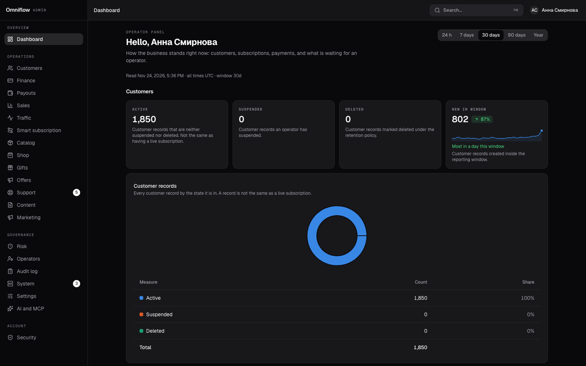
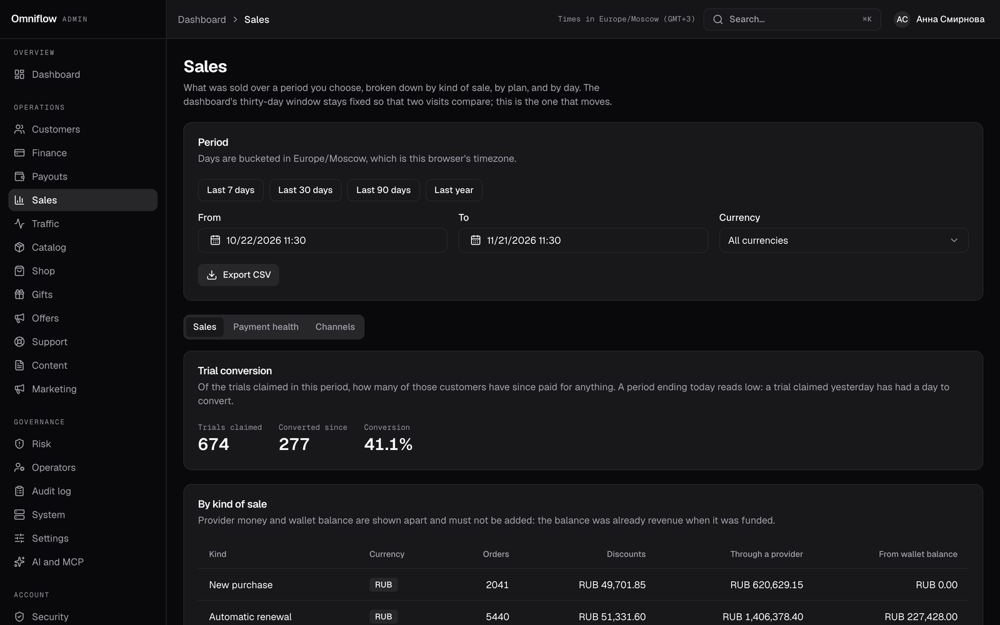
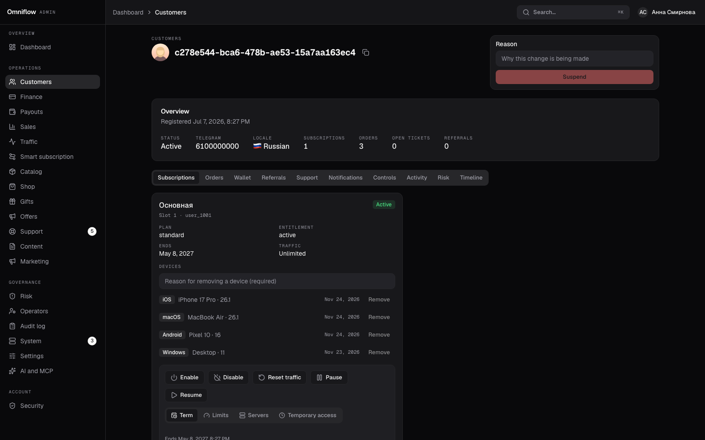
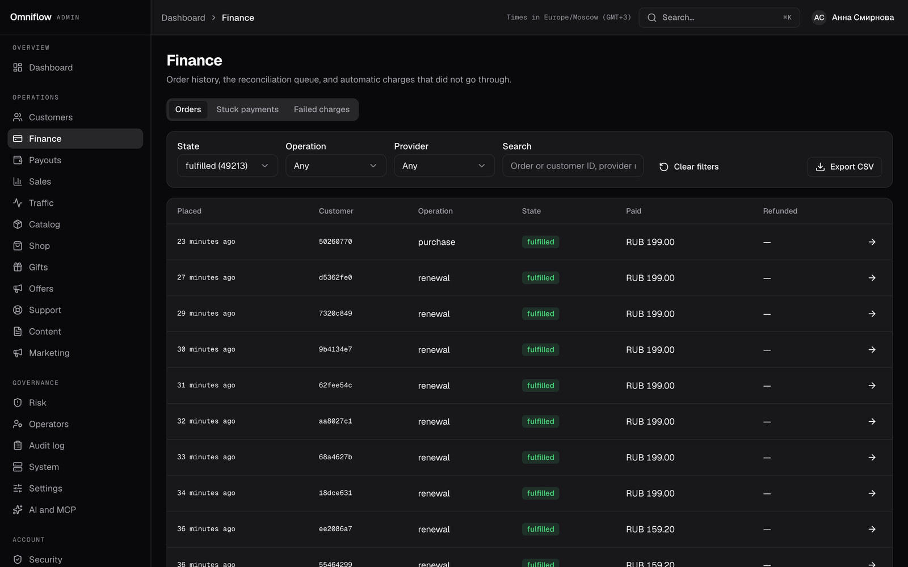
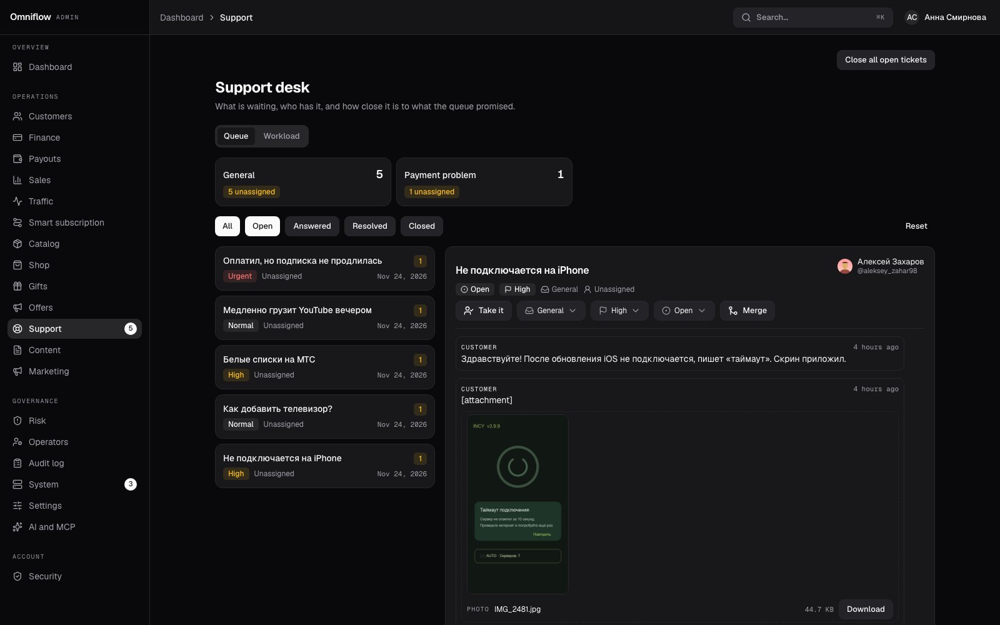
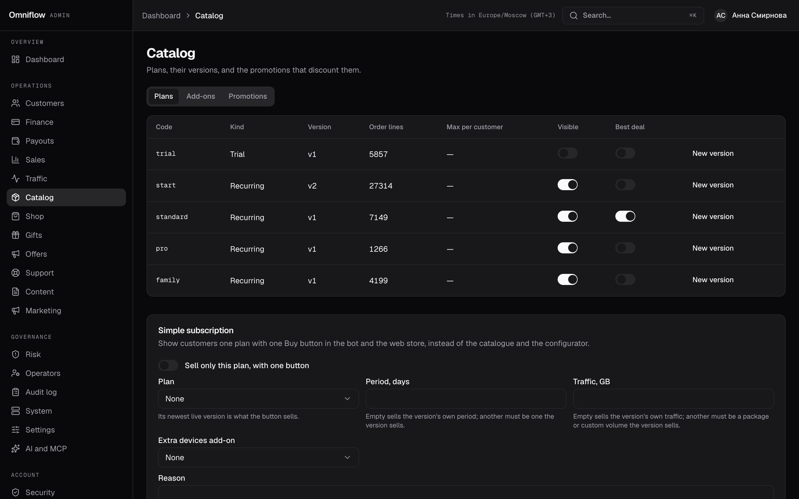
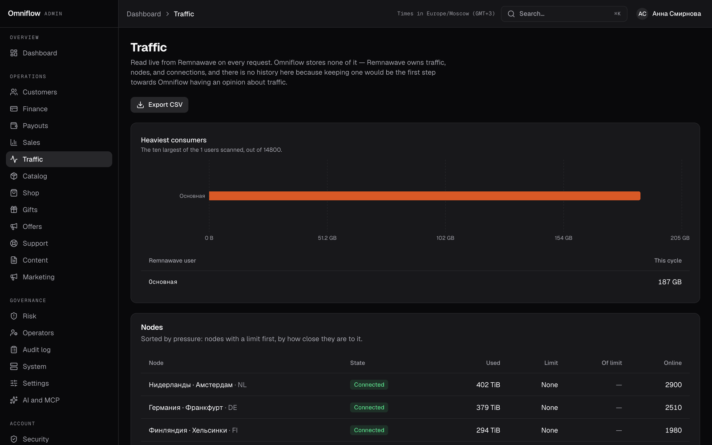
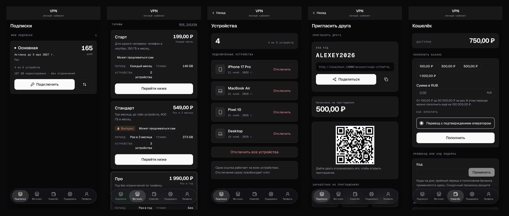
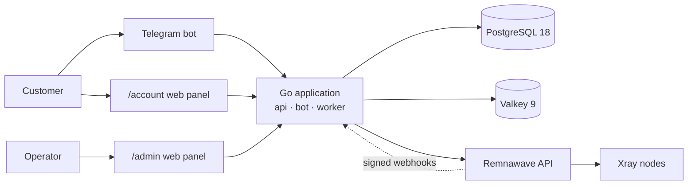

<!-- markdownlint-disable MD013 MD033 MD041 -->

<h1 align="center">🌊 Omniflow</h1>

<p align="center">
  <b>Sell, support, and run your Remnawave VPN from one self-hosted platform.</b><br>
  A Telegram bot, a customer web panel, and an operator panel, installed on your own server next to your Remnawave installation.
</p>

<p align="center">
  <a href="#-self-host-it"><b>🚀 Self-host it</b></a>
  &nbsp;·&nbsp;
  <a href="./docs/operations/migrate-from-bedolaga.mdx">Coming from Bedolaga</a>
  &nbsp;·&nbsp;
  <a href="./docs/index.mdx">Documentation</a>
  &nbsp;·&nbsp;
  <a href="./docs/comparison.mdx">Comparison</a>
</p>

<p align="center">
  <a href="https://github.com/kewldan/omniflow/releases/latest"></a>
  <a href="https://github.com/kewldan/omniflow/actions/workflows/ci.yml"></a>
  <a href="./LICENSE"></a>
  
  <br>
  
  
  
  
  <a href="https://docs.rw/api/"></a>
  <br>
  
  
  
  
  
</p>

<p align="center">
  
</p>

> [!NOTE]
> The screenshots come from a demo installation filled with generated data: customers, orders, and payments are fake.

## ✨ Highlights

- 🤖 **A complete Telegram bot.** Plans, checkout, renewals, upgrades, devices, connection guides, support tickets, referrals, gifts, news, and a Telegram Stars and Premium shop, all in one message that updates as the customer moves through it.
- 🖥️ **Two web panels in one app.** The customer panel at `/account` mirrors the bot, so a cart started in the chat is the cart the browser shows. Operators work in `/admin`, which needs no SQL and no shell for anything.
- 💳 **29 payment providers.** YooKassa with 54-FZ receipts, Telegram Stars, CryptoBot, and 25 regional collectors carried over from Bedolaga. Each method can be its own button, with its own limits and visibility rules. Saved cards and mandates renew subscriptions automatically, and only with the customer's explicit consent.
- ⭐ **A Stars shop on your own wallet.** Customers buy Telegram Stars and Premium, and Omniflow delivers them through Fragment from your own TON wallet. The wallet's secrets live only in environment variables.
- 🧮 **Money handled like money.** Every order and payment mutation is idempotent, provider webhooks are replay-safe, and wallet balances come from an append-only double-entry ledger. Refunds and chargebacks reported by a provider take back what they paid for.
- 📈 **Growth tools.** Campaigns with `/start` links and UTM attribution, percentage referral commissions, a second referral level and referral contests, loyalty groups, personal offers, win-back waves with a discount, a fortune wheel, polls, and seven daily games, partner applications with personal rates, and broadcasts by Telegram and e-mail.
- 🎫 **A real support desk.** Queues, assignment, SLA timers, internal notes, canned replies, customer topics and urgency, and an operator Telegram group with auto-created topics.
- 🔗 **Remnawave-native.** Omniflow uses Remnawave's public API only. It receives the panel's signed webhooks, encrypts Happ and INCY links, and reads devices and traffic live. Remnawave stays the owner of users, nodes, and traffic.
- 🔐 **Operator security.** Argon2id passwords, passkeys, TOTP, optional OIDC, custom roles, and an append-only audit trail. Every adverse action needs a reason, and secrets are write-only by construction.
- 🛡️ **Private by default.** Omniflow keeps no subscription links, HWIDs, or customer IP addresses. Advertising measurement is off until you turn it on, and the anonymous installation telemetry can be switched off with one variable.

## 📸 Screenshots

| Sales | Customer card |
| :---: | :---: |
|  |  |
| **Finance** | **Support desk** |
|  |  |
| **Catalog** | **Traffic** |
|  |  |

**The customer panel on a phone**: subscriptions, the plan store, devices, invitations, and the wallet.

<p align="center">
  
</p>

## 🚀 Self-host it

Omniflow runs on your server, next to (or far from) your Remnawave panel. Nothing is hosted for you and nothing phones home except the [anonymous telemetry](#-privacy-and-telemetry), which you can turn off.

> [!IMPORTANT]
> You need **Docker with Compose v2**, a reachable **Remnawave 3.4.x** installation with an API token, and a **Telegram bot token** from [@BotFather](https://t.me/BotFather). A public HTTPS domain is needed for payment webhooks and the web panels.

1. **Get the code and the config.**

   ```bash
   git clone https://github.com/kewldan/omniflow.git && cd omniflow
   cp .env.example .env
   ```

2. **Fill in `.env`.** At minimum: `APP_REMNAWAVE_URL`, `APP_REMNAWAVE_TOKEN`, `APP_TELEGRAM_TOKEN`, `APP_PUBLIC_URL`, `APP_OPERATOR_TOKEN`, and `APP_DATA_ENCRYPTION_KEY` (`openssl rand -base64 32`). Every project variable starts with `APP_`; payment providers are switched on by setting their own `APP_<PROVIDER>_*` keys. See [Configuration](./docs/getting-started/configuration.mdx).

3. **Start everything.**

   ```bash
   docker compose --profile web up -d --build
   ```

   This runs PostgreSQL, Valkey, the migrations, the API, the bot, the background worker, and the web app. Check it with `curl http://localhost:8080/healthz`.

4. **Put it behind HTTPS.** Route your domain to the web service (port 3000) and `/v1` to the API, as the Caddy and Traefik examples in [`deploy/proxies`](./deploy/proxies) do. See [Reverse proxy](./docs/operations/reverse-proxy.mdx).

5. **Create the first owner.** On first start the API prints a one-time setup token to its log (`docker compose logs api`). Redeem it at `https://your-domain/admin/setup`, then configure plans, providers, branding, and the bot from the panel.

<details>
<summary>⬆️ Upgrading</summary>

```bash
git pull
docker compose --profile web up -d --build
```

The `migrate` service applies new database migrations before the API, bot, and worker start. Encrypted backups run on a schedule once `APP_BACKUP_ENABLED=true`; see [Backup and restore](./docs/operations/backup-restore.mdx).

</details>

<details>
<summary>🧪 Trying it locally without HTTPS</summary>

A local stack speaks plain HTTP, and browsers do not send a `Secure` cookie back over it. Turn the flag off for local use only:

```env
APP_ADMIN_COOKIE_SECURE=false
APP_CUSTOMER_COOKIE_SECURE=false
```

Then open the customer panel at <http://localhost:3000> and the operator panel at <http://localhost:3000/admin>.

</details>

The full guides: [Quick start](./docs/getting-started/quickstart.mdx) · [Deployment](./docs/operations/deployment.mdx) · [Your first sale](./docs/getting-started/first-sale.mdx) · [Troubleshooting](./docs/operations/troubleshooting.mdx).

## 🔁 Coming from Bedolaga

Omniflow covers the Bedolaga bot and cabinet feature by feature: payment providers, the Stars shop, promo codes, referrals, campaigns, win-back waves, and e-mail sign-in. Moving over is a scripted, rehearsable cutover.

| Step | Tool |
| --- | --- |
| Convert Bedolaga's `.env` into Omniflow's | [`deploy/migration/00-convert-env.sh`](./deploy/migration) |
| Plan the import and see every conflict before writing anything | `migrate-bedolaga plan` |
| Import customers, balances, subscriptions, referrals, promo codes, and OAuth links | `migrate-bedolaga apply` |
| Check that totals and balances match | `migrate-bedolaga verify` |
| Switch the bot over and roll back if needed | `deploy/migration/06-cutover.sh`, `07-rollback.sh` |

Read [Migrating from Bedolaga](./docs/operations/migrate-from-bedolaga.mdx) before you start. Every Bedolaga capability and its status in Omniflow is listed in [`bedolaga-bot-gaps.md`](./bedolaga-bot-gaps.md).

## 💳 Payments

| Kind | Providers |
| --- | --- |
| Bank cards, SBP, and wallets | YooKassa (with 54-FZ receipts), CloudPayments, Platega, FreeKassa, KassaAI, Lava, MulenPay, Pal24, Overpay, Antilopay, PayHot, CisPay, Cashera, WATA, Tribute, RioPay, SeverPay, RollyPay, AuraPay, ParityPay, Anore, Donut, Etoplatezhi, Jupiter, TabPay |
| Crypto | CryptoBot, Heleket |
| Telegram | Telegram Stars, including Stars at ruble prices |
| Your own | Manual transfer with operator confirmation, and top-up through support |

Self-employed receipts go to «Мой налог» through NaloGO. Guest purchases need no account. See [Payment providers](./docs/integrations/payment-providers.mdx) for the full list and each provider's settings.

## 🛡️ How money stays correct

- 🔑 **Idempotent by default.** Every order and payment mutation carries an idempotency key, so a double click, a retried request, or a replayed webhook settles once.
- 📒 **An append-only ledger.** Wallet balances are derived from double-entry ledger lines. A correction is a compensating entry, never an update, and a balance cannot go negative.
- 📨 **Replay-safe webhooks.** Provider callbacks are verified, stored raw, and processed once. A provider that cannot be verified is polled instead of trusted.
- 🚚 **Fulfillment that cannot lose a payment.** Access is granted in Remnawave by durable jobs with retries and drift detection. A paid order waits out a Remnawave outage instead of failing.
- 🧾 **Reasons on every adverse action.** Refunds, suspensions, and balance corrections need a reason and leave an audit event with the before and after state.

The invariants are written down and tested; see [Financial invariants](./docs/commerce/financial-invariants.mdx).

## 🏗️ Architecture



- **Remnawave owns** VPN users, traffic, devices, access links, nodes, squads, and Xray state.
- **Omniflow owns** customers, plans, orders, payments, the wallet ledger, support, campaigns, referrals, loyalty, operators, and the audit trail.
- Omniflow never connects to Remnawave's database and never manages nodes. See [Data ownership](./docs/architecture/data-ownership.mdx) and the [decision records](./docs/architecture/decisions.mdx).

| Layer | Technology |
| --- | --- |
| Backend | Go 1.27, Chi, pgx, sqlc, River jobs, transactional outbox, OpenAPI, OpenTelemetry |
| Data | PostgreSQL 18 with Atlas migrations, Valkey 9 |
| Web | Next.js 16, React 19, TypeScript 7, Tailwind CSS 4, shadcn/ui, SWR |
| Tooling | Bun workspaces, Biome, Orval, Mintlify, Playwright, Testcontainers |
| Delivery | GitHub Actions, Release Please, Renovate, Trivy, Gitleaks, CodeQL, Cosign-signed images |

<details>
<summary>🗂️ Project layout</summary>

```text
apps/web/             Customer (/account) and operator (/admin) Next.js app
cmd/api/              REST API process
cmd/bot/              Telegram bot process
cmd/worker/           Background worker: fulfillment, renewals, backups, reports
cmd/migrate-bedolaga/ Import from a Bedolaga database
internal/             Domain packages: commerce, payments, botapp, remnawave, …
packages/api-client/  Generated Fetch, SWR, and Zod bindings
packages/ui/          Shared shadcn component system
database/             Schema, Atlas migrations, and sqlc queries
deploy/               Reverse-proxy examples, observability, Bedolaga migration scripts
docs/                 Mintlify documentation in English and Russian
```

</details>

## 🌍 Localization

The bot, both web panels, and the documentation are complete in **Russian** and **English**. **Ukrainian**, **Chinese**, and **Persian** cover every string of the bot and both web panels as machine translations awaiting a native speaker's review; Persian renders right to left. The operator chooses which languages customers can pick.

## 📡 Privacy and telemetry

Anonymous installation telemetry is on by default and helps decide what to build next. It never includes customer identities, Telegram IDs, payment amounts, traffic, domains, tokens, links, or message text. Turn it off with:

```bash
APP_TELEMETRY_ENABLED=false
```

The exact payload is shown in the operator panel before anything is sent; see [Anonymous telemetry](./docs/operations/telemetry.mdx). Advertising measurement for your own storefront is a separate switch, off by default, reported only to your own analytics provider; see [Advertising measurement](./docs/operations/advertising-measurement.mdx).

## 🗺️ Known limitations

- 💸 Payments always open the provider's page; paying by SBP QR code inside the bot, Overpay's foreign-card terminal, and embedded CloudPayments or MulenPay forms are not supported yet.
- 🛡️ No integration with an external ban system or abuse API, no time- or address-based operator policies, and no log viewer in the panel yet.
- 🍏 Apple In-App Purchase waits for a native app ([decision 0014](./docs/architecture/decisions.mdx)).
- 🧭 Node management, per-node traffic limits, and Omniflow's own traffic accounting are deliberately left to Remnawave.

Everything still open is tracked in [`BACKLOG.md`](./BACKLOG.md) and [`ROADMAP.md`](./ROADMAP.md).

## 🤝 Contributing

Contributions are welcome. Read [CONTRIBUTING.md](./CONTRIBUTING.md) and [AGENTS.md](./AGENTS.md), check the [architecture](./docs/architecture/overview.mdx) and the ownership boundary, run the relevant `make help` targets, and use a focused [Conventional Commit](https://www.conventionalcommits.org/). Building on top of Omniflow rather than in it? The [extension policy](./docs/integrations/extending.mdx) says which surfaces are stable.

Questions and bug reports go through [SUPPORT.md](./SUPPORT.md). Report security issues privately as described in [SECURITY.md](./SECURITY.md).

## 📄 License

Omniflow is released under the [Apache License 2.0](./LICENSE). Copyright © 2026 Omniflow contributors.
