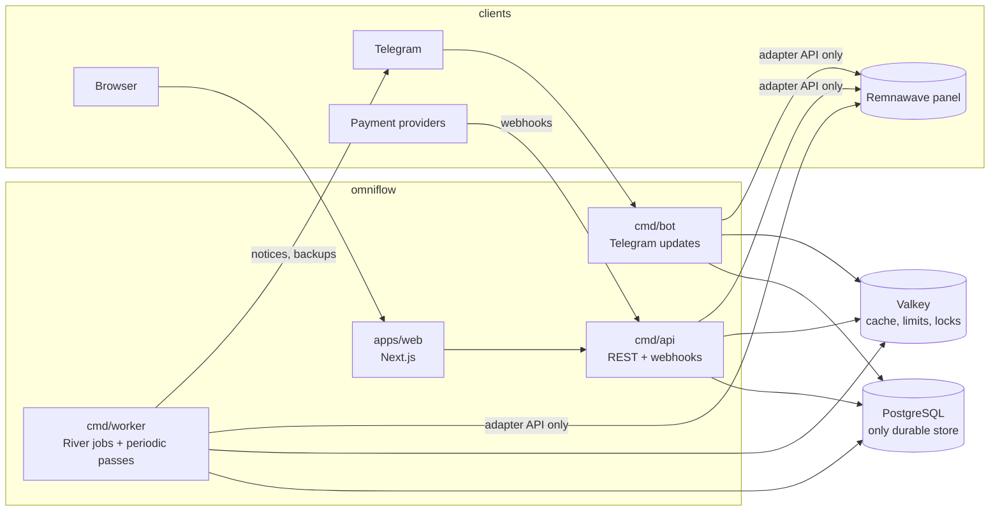
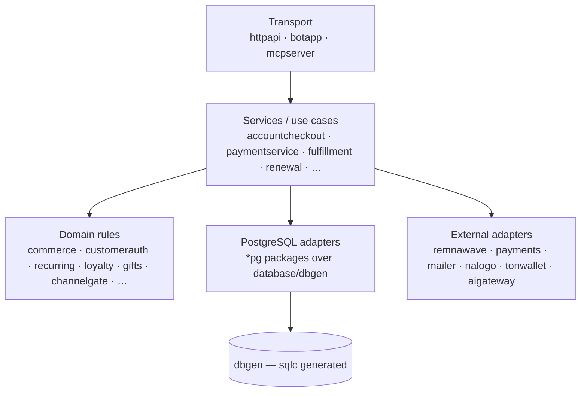

# Repository graph

A map of the repository: what each part is, what depends on what, and where to
go for a given change. The rules live in [`AGENTS.md`](./AGENTS.md); the product
documentation lives in [`docs/`](./docs). This file only tells you where things
are. Keep it in step when a package, process, or top-level directory is added,
removed, or renamed.

## Top level

```text
omniflow/
├── cmd/                  Go entrypoints: api, bot, worker, migrate-bedolaga
├── internal/             Go packages (domain, adapters, transport) — ~100 packages
├── api/openapi.yaml      REST contract (OpenAPI 3.0.3), the source for generated code
├── database/
│   ├── migrations/       Atlas migrations + atlas.sum (generated by `atlas migrate hash`)
│   ├── queries/          sqlc query files → internal/database/dbgen
│   └── schema.sql        generated snapshot (`make schema-snapshot`), never hand-edited
├── apps/web/             Next.js app: customer cabinet (/account) and operator panel (/admin)
├── packages/
│   ├── ui/               shared shadcn primitives used by both surfaces
│   └── api-client/       Orval-generated TypeScript client and Zod schemas
├── docs/                 Mintlify docs, English at the root, Russian mirror in docs/ru/
├── deploy/               migration scripts from Bedolaga, Prometheus/Grafana, proxy configs
├── build/                Dockerfiles for the Go image and the web image
├── tools/                generate.go, schema snapshot, restore and volume drills
├── compose.yaml          reference deployment: postgres, valkey, api, bot, worker, web
└── Makefile              dev, generate, atlas-*, schema-snapshot, docs-check, security
```

Root notes: `README.md` (product), `ROADMAP.md` and `BACKLOG.md` (plans),
`bedolaga-bot-gaps.md` and `bedolaga-features.md` (parity with Bedolaga),
`CHANGELOG.md` (release-please), `*-audit.md` and `fixes.md` (UX audit notes).

## Processes

Three processes from one Go module and one database. The web app is a fourth
container that talks only to the API.



| Process | Entry | Owns |
| --- | --- | --- |
| api | `cmd/api/main.go` | `/v1/panel`, `/v1/admin`, `/v1/account`, payment webhooks, Remnawave webhooks, SSE live streams |
| bot | `cmd/bot/main.go` | the customer Telegram bot and operator Telegram commands; exactly one instance |
| worker | `cmd/worker/main.go`, `backup.go`, `growth.go` | River workers and periodic passes (below) |
| migrate-bedolaga | `cmd/migrate-bedolaga/main.go` | one-off import from a Bedolaga database |

All three build the shared commerce core through `internal/app` (composition
root, also used by the integration harness). Construction is plain constructors;
there is no DI framework.

Worker periodic passes (names as registered): `fulfillment_reconcile`,
`fulfillment_revive`, `payment_reconcile`, `renewal`, `daily_billing`,
`commerce_maintenance`, `lifecycle_sweep`, `dormant_customers`,
`loyalty_evaluation`, `anomaly_evaluation`, `campaign_expansion`,
`bulk_actions`, `goods_delivery_schedule`, `blocked_bot_subscriptions`,
`device_overflow_report`, `traffic_monitor_fast`, `traffic_monitor_daily`,
`support_sla`, `operator_reports`, `backup`, `backup_requests`, `retention`,
`customer_activity_prune`, `api_token_log_prune`, `release_check`,
`remnawave_auto_import`, `webhooks` (outbox fan-out), `email_delivery`,
`guest_purchases`, `self_employed_receipts`.

## Layers inside `internal/`



Domain packages import none of transport, `dbgen`, Telegram, or provider
packages. A package ending in `pg` is the PostgreSQL half of the package
without the suffix (`commerce` → `commercepg`, `customerauth` →
`customerauthpg`).

## Package index

**Transport**
- `httpapi` — every HTTP route, middleware (sessions, CSRF, RBAC, rate limits, request IDs), webhooks, SSE.
- `botapp` — the Telegram bot: menus, purchase flows, gifts, shop, referrals, support, operator commands.
- `mcpserver` — Omniflow's admin capabilities over MCP (not wired into a process yet).

**Commerce core**
- `commerce` (rules: pricing, quotes, promotions, delivery policy), `commercepg` (orders, settlement, offers, credits).
- `catalogpg` — plans, versions, add-ons, squads.
- `accountcheckout` — customer checkout, shared by web and bot; personal offers.
- `paymentservice` — provider selection, intents, webhooks into settlement.
- `payments` — ~30 provider adapters (`yookassa`, `cryptobot`, `telegram_stars`, `heleket`, `platega`, `tribute`, `overpay`, …) behind `provider.go` / `registry.go`.
- `walletpost` — balanced two-entry ledger movements.
- `fulfillment` — provisioning operations against Remnawave, retries, drift.
- `recurring` (rules) · `recurringpg` · `renewal` (worker) — auto-renew.
- `gifts`, `guestpurchase`, `accesscode` — gifts, claim codes, purchases without an account.
- `goods`, `goodsdelivery`, `tonwallet`, `tonrate` — digital goods (Stars/Premium via Fragment).
- `fxrate` — currency and Stars rates.
- `selfemployed`, `nalogo` — «Мой налог» receipts.

**Customers and identity**
- `customer`, `customerpg` — customer records; `customerauth`, `customerauthpg`, `websession` — sign-in (Telegram, OIDC, e-mail link), sessions, linking identities.
- `accountpg`, `accountreferral`, `accountshop`, `accountsupport` — the customer web cabinet's read and action models.
- `dormancy`, `retention`, `sweeper`, `blockedbot` — lifecycle passes.
- `termsgate`, `channelgate`, `channelworker` — terms acceptance and required channels.
- `sharing` — account-sharing signal from Remnawave devices.
- `telegramavatar` — profile photos for the customer card.

**Growth**
- `loyalty`, `referralpayout`, `referralplus` — tiers, withdrawals, second level, contests, partners.
- `campaigns`, `audience`, `adtracking`, `engagement` — campaigns, segments, ad measurement, wheel, polls, games.
- `bulkrunner` — previewed bulk actions.

**Operator side**
- `panelpg` — the operator panel's PostgreSQL adapter (largest package).
- `panelsearch`, `panelsearchpg` — command palette search.
- `adminauth`, `adminauthpg`, `rbac` — operator auth (password, TOTP, passkeys) and the compiled-in permission catalogue.
- `operator` — Telegram notices to the operator group, backup file delivery.
- `anomaly`, `blocklist`, `linkcheck` — risk signals.
- `installsettings`, `branding`, `notice`, `infopage`, `connectpg`, `maintenance` — operator-editable settings and content.
- `importservice`, `bedolagaimport`, `bedolagaimportpg`, `bedolagasource` — imports.
- `backup` — encrypted, verified PostgreSQL backups and restore.
- `errorlog`, `updatecheck`, `telemetry` — operations.

**AI (optional, off by default)**
- `aigateway` (front door), `airuntime`, `airedact`, `aigovernance`, `aidraft`, `aisupport`, `aimarketing`, `aiknowledge`, `airisk`, `aicopilot`, `aieval`, `mcp`. Only the provider connection test is reachable from a screen today.

**Infrastructure**
- `config` — every `APP_*` variable. `database` (+ `database/dbgen`, generated), `jobs` (River clients), `platform` (Valkey, rate limits, metrics, tracing, redaction), `egress` (outbound HTTP to operator-supplied addresses), `mailer`, `emailpg` (e-mail outbox), `remnawave` (versioned adapter), `remnawavesync`.
- `integrationtest` — Testcontainers suites behind the `integration` build tag.

## Web app (`apps/web`)

```text
app/
├── (public)/                      landing, sign-in, legal, guest checkout
├── (customer)/account/(panel)/    subscriptions, store, checkout, devices, wallet, renewal,
│                                  offers, gifts, shop, referrals, support, news, orders,
│                                  profile, security, preferences, privacy
└── (admin)/admin/(panel)/         customers, finance, payouts, reports, traffic, catalog, shop,
                                   gifts, offers, support, content, marketing, risk, operators,
                                   audit, system, settings, security
messages/{en,ru,uk,zh,fa}.json     next-intl catalogues
```

Data goes through the shared typed transport over the Orval-generated client in
`packages/api-client`; UI primitives come from `packages/ui`.

## Generated artifacts and their sources

| Generated | Source | Command |
| --- | --- | --- |
| `internal/database/dbgen/` | `database/queries/*.sql` + migrations | `go tool sqlc generate` |
| Go server types | `api/openapi.yaml` | `go tool oapi-codegen -config api/oapi-codegen.yaml api/openapi.yaml` |
| `packages/api-client` | `api/openapi.yaml` | `bun run generate:api` |
| `database/migrations/atlas.sum` | migration files | `make atlas-hash` (never by hand) |
| `database/schema.sql` | applied migrations | `make schema-snapshot` |
| `CHANGELOG.md` | Conventional Commits | release-please |

## Where to change what

| Change | Start in |
| --- | --- |
| New API route | `api/openapi.yaml` → regenerate → `internal/httpapi/*` → service package → `docs/` |
| New table or column | new file in `database/migrations/` → `make atlas-hash` → apply → `make schema-snapshot` → `database/queries/` → sqlc |
| Price, quote, or discount rule | `internal/commerce`, then `internal/commercepg` |
| Payment provider | `internal/payments/<provider>.go`, `registry.go`, `docs/integrations/payment-providers.mdx` |
| Anything that touches Remnawave | `internal/fulfillment` (operations), `internal/remnawave` (adapter) — never its database |
| Bot screen or button | `internal/botapp` (routes, views, messages) |
| Customer web screen | `apps/web/app/(customer)/account/(panel)/…` + `internal/account*` |
| Operator panel screen | `apps/web/app/(admin)/admin/(panel)/…` + `internal/panelpg` + permission in `internal/rbac` |
| Periodic job | `cmd/worker/main.go` registration + the package that does the work |
| Setting an operator can edit | `internal/installsettings` section + panel settings screen + `docs/operations/installation-settings.mdx` |
| UI copy | `apps/web/messages/*.json` (all five catalogues) |
| A decision with long-term consequences | a section in `docs/architecture/decisions.mdx` and its Russian mirror |

## Checks

| What | Command |
| --- | --- |
| Go unit tests | `go test -race ./...` |
| Integration (Docker) | `go test -tags integration -timeout 50m ./internal/integrationtest/` |
| Web lint and format | `bun run check` |
| Web unit tests, bundle budget | `cd apps/web && bun run test`, `bun run build && bun run perf:budget` |
| Docs | `make docs-check` (Mintlify validate, broken links, `docs/scripts/check-russian-mirror.sh`) |
| CI | `.github/workflows/ci.yml` |
