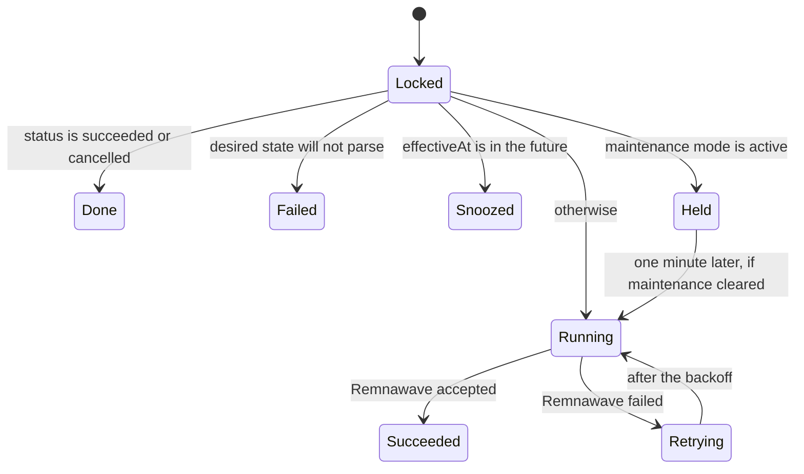

Omniflow moves work off the request path in two different ways, and the difference matters when something is stuck.

Work that is **about one record** and must survive a restart goes on a durable queue: River, running against the same PostgreSQL database, with the job row inserted in the same transaction as the state change that requires it. Work that is **a whole-table pass** — expiring orders, sweeping carts, refreshing blocklists, deleting yesterday's sessions — runs as a River periodic job on the worker, so it runs once per interval across the installation however many worker replicas are up. A few loops that only touch their own process stay plain in-process tickers.

Only the `worker` process executes jobs. The API and the bot each create a River client for *inserting* and never register a worker: a settlement that closes in either process — a provider webhook in the API, a Telegram Stars payment or a wallet-covered order in the bot — inserts its fulfillment job in the paying transaction.

## The durable queue

Three queues exist, with fixed concurrency compiled in:

| Queue | Max workers | Carries |
| --- | --- | --- |
| `critical` | 16 | `fulfillment` and `goods_delivery` — a customer has already paid by the time either runs |
| `default` | 8 | `periodic_task` — the [periodic passes](#periodic-passes-and-in-process-loops) |
| `bulk` | 4 | Nothing today |

That is 28 jobs at once, and the worker's database pool is sized against it — see [Deployment](/operations/deployment#database-connections).

### Job kinds

| Kind | Arguments | Queue | Max attempts | Uniqueness |
| --- | --- | --- | --- | --- |
| `fulfillment` | `{"operationId": …}` | `critical` | 12 | Unique by arguments |
| `goods_delivery` | `{"orderId": …}` | `critical` | 12 | Unique by arguments |
| `periodic_task` | `{"task": "<name>"}` | `default` | 1 | Unique by arguments while available, pending, retryable, running or scheduled |

Uniqueness by arguments is what makes a duplicated enqueue — from a replayed webhook, a retried settlement, or an operator clicking twice — collapse into the existing job rather than racing it.

### Why the job is inserted in the paying transaction

The rule the code follows is that a durable job is enqueued in the same PostgreSQL transaction as the state change that requires it. Settling an order and inserting its fulfillment job commit together, which is what makes "a paid order always has a job waiting for it" true. The alternative — settle, commit, then enqueue — has a window in which the process can die between the two, leaving a customer who has paid and a queue that has never heard of them.

The same property makes retries safe. A fulfillment operation carries a unique `idempotency_key`, so River's at-least-once delivery cannot double-apply it, and a retry from the panel re-queues under that same key rather than creating a second operation.

### The queue schema ships with the migrations

River keeps its own tables (`river_job`, `river_leader`, `river_queue`, `river_notification`, `river_migration`). The Atlas migration `20260905110000_river_queue.sql` creates them: it is River's own `main` migration line for the linked River version, copied verbatim, followed by the `river_migration` rows River's `rivermigrate` would have written. The compose `migrate` service therefore leaves a database on which the worker starts and the API and the bot can insert jobs, with no step outside the documented deployment path.

An installation that already created those tables by hand with the River CLI keeps them: the migration skips its whole body when `river_migration` already exists.

The integration suite checks after every migration run that `rivermigrate` reports no unapplied River version, so upgrading River to a release with a new schema version fails in CI until a matching migration is committed.

## Fulfillment jobs

A `fulfillment` job applies one desired entitlement state to Remnawave. It is the only path by which Omniflow writes to the panel, which is why every retry, hold and refusal below is written to a record an operator can read afterwards. The commerce side of it is described in [Fulfillment](/commerce/fulfillment).

The worker opens a serializable transaction, locks the operation row, and then:

- **Unparseable desired state** marks the operation `failed` with the code `invalid_desired_state`, notifies operators, and cancels the job. Retrying it would fail identically twelve times.
- **A future `effectiveAt`** snoozes the job until that moment instead of burning attempts on a scheduled change that is not due.
- **Maintenance mode** parks the operation as `retrying` with `last_error_code = maintenance_active` and snoozes for one minute. The attempt count is decremented back first, so a hold costs no retry budget however long the window lasts. See [Maintenance mode](/operations/maintenance-mode).
- **A provider failure** stores a classified error code and a `next_attempt_at` computed as `5s × 2^attempt`, capped at the eighth attempt — so the backoff runs 10s, 20s, 40s … up to 1280 seconds between tries.

Supported operations are `create`, `reconcile`, `extend`, `set_limits`, `set_squads`, `enable`, `disable` and `reset_traffic`. Anything else cancels the job rather than retrying it.

After **three** failed attempts — and immediately on a permanent failure — the worker queues an operator notice on the `fulfillment_failure` topic, deduplicated on `operation:<id>` so one struggling entitlement produces one message however many times it retries. The notice carries the entitlement ID, the operation, the classified error code and the status — never a Remnawave response body. See [Operator notifications](/operations/operator-notifications).

A `reconcile` operation also compares the local desired state with what Remnawave reports and records any mismatch as an entitlement drift (`missing_remote`, `expiry`, `traffic`, `device_limit`, `squads`, `status`). A successful apply resolves the open drifts for that entitlement.

## Digital-goods delivery jobs

A `goods_delivery` job hands one paid shop order to its provider. The guarantee it has to keep is that a paid order is submitted **at most once**, and the shape of the worker is that guarantee:

1. A short transaction locks the delivery row, refuses anything already resolved, and claims the next attempt — incrementing the counter and pushing the retry deadline out *before* the provider is called. That transaction commits.
2. The provider call happens outside any transaction. A worker that dies here leaves a row already marked submitted with its deadline moved, so nothing picks it up immediately and re-buys.
3. A second transaction records the outcome.

The `goods_deliveries` row, not the queue, is the source of truth about what is owed. River's twelve attempts cover failures that never reached the provider — a brief database outage, a lost connection — while the row's own attempt count governs how many times the provider is actually asked. The larger River budget therefore cannot turn into extra purchases. An adapter that returns an error rather than a classified outcome is treated as an ambiguous failure with the code `adapter_error`, because "we do not know whether the purchase happened" is not the same as "it did not".

This worker exists only when `APP_DATA_ENCRYPTION_KEY` is set on the worker, since a provider credential cannot be unsealed without it. Without the key the worker logs `digital goods delivery disabled` and runs everything else.

<Note>
  Digital-goods delivery is uninstrumented: it opens no trace span and records no job metric, so `omniflow_jobs_total{kind="goods_delivery"}` never appears. Watch it through the panel's shop views rather than through Prometheus. See [Health, metrics, and logs](/operations/observability#what-is-declared-but-never-written).
</Note>

## The dead-letter queue, retries and cancellation

There are two operator surfaces and they show different things. Reach for the right one.

### River rows, over the bearer token

`GET /v1/admin/jobs` lists actual queue rows and is the only place a job that never produced a fulfillment operation is visible.

| Parameter | Values |
| --- | --- |
| `state` | `dead_letter` (the default; discarded plus cancelled), `retryable`, `running`, `available`, `scheduled`, `completed`. Anything else answers `400 invalid_state` |
| `limit` | 1–200, default 50 |

Each row returns the ID, kind, queue, state, attempt and max attempts, created and attempted timestamps, the error count, and the **last error passed through the redactor**. Job arguments are summarised rather than echoed, because they carry identifiers that belong behind the records they point at.

- `POST /v1/admin/jobs/{jobID}/retry` moves a job back to available.
- `POST /v1/admin/jobs/{jobID}/cancel` cancels it.

Either answers `422 job_mutation_rejected` when the job's current state forbids the change, and both answer `503 jobs_unavailable` in a process that has no job client. All three routes are authenticated with `APP_OPERATOR_TOKEN`; see [Admin API](/integrations/api).

### Fulfillment operations, in the panel

`/admin/system` → **Jobs** (permission `system.read`) is hard-filtered to failed fulfillment operations, which is the dead-letter view an operator actually needs: created-at, operation, attempt count, error code and correlation ID. It never shows a provider payload or a Remnawave response body — a status, a classification and a correlation identifier is what you need to decide whether to retry, and none of it can leak a subscription link onto an operator's screen.

With `system.write`:

- **Retry** re-queues the same operation under the **same idempotency key**, so the worker still performs it exactly once.
- **Cancel** abandons an operation that has not succeeded.

A **succeeded** operation is neither retryable nor cancellable, and the refusal is a `409 state_conflict` enforced in SQL rather than checked in Go. Retracting a completed provisioning by panel click would leave the entitlement and Remnawave disagreeing with no record of why.

Every panel mutation requires an `X-Operator-Reason` header and writes an audit event — `panel.fulfillment.retried` or `panel.fulfillment.cancelled`, category `system`. The attempt history behind an operation is available at `GET /v1/panel/system/jobs/{operationID}/history` with the status, correlation ID, error code and time of each attempt; the stored request and response summaries are deliberately never returned.

| Route | Permission |
| --- | --- |
| `GET /v1/panel/system/jobs` | `system.read` |
| `GET /v1/panel/system/jobs/{operationID}/history` | `system.read` |
| `POST /v1/panel/system/jobs/{operationID}/retry` | `system.write` |
| `POST /v1/panel/system/jobs/{operationID}/cancel` | `system.write` |

## Periodic passes and in-process loops

### Periodic passes on the worker

Every whole-table pass that changes state is a River periodic job of kind `periodic_task`, run by the worker. Only River's elected leader among the running worker clients enqueues them: each pass runs once when the leader starts, then once per interval, so it runs once per interval across the installation however many worker replicas are up. Its uniqueness keeps a pass that outlasts its interval from being queued again beside itself; a finished pass releases it.

A pass gets one attempt. A failure is logged as `periodic task failed` with the task name, the job ends discarded — visible in `GET /v1/admin/jobs?state=dead_letter` — and the next interval runs a fresh pass over the same rows. A run is cancelled after its interval, except where the table says otherwise.

| Task | Interval | Run timeout | What it does |
| --- | --- | --- | --- |
| `commerce_maintenance` | 1 min | interval | Expires pending orders, expires wallet credits as a double-entry `expiration` transaction, sweeps saved carts |
| `payment_reconcile` | 1 min | interval | Re-polls up to 100 in-flight payment intents |
| `renewal` | 1 min | 5 min | Charges due renewals in batches of 100 |
| `fulfillment_reconcile` | 15 min | interval | Creates `reconcile` operations for up to 500 entitlements, keyed `reconcile:<entitlementID>:<15-minute bucket>` |
| `fulfillment_revive` | 5 min | interval | Re-queues fulfillment operations whose job never ran or was discarded |
| `lifecycle_sweep` | 5 min | interval | Expires gifts and personal offers, refreshes up to 20 blocklist sources |
| `anomaly_evaluation` | 15 min | interval | Evaluates anomaly rules |
| `campaign_expansion` | 1 min | 5 min | Expands campaign audiences, batch 5 000 |
| `bulk_actions` | 15 s | 5 min | Applies previewed bulk operations one item at a time, batch 50 |
| `retention` | `APP_RETENTION_INTERVAL_HOURS` (1 h) | interval | Seven cleanup steps, below |
| `goods_delivery_schedule` | 30 s | interval | Enqueues up to 200 due deliveries |
| `backup` | `APP_BACKUP_INTERVAL_HOURS` (24 h) | none | Encrypted `pg_dump` plus prune |

The fulfillment reconcile pass's bucketed idempotency key is worth understanding: two passes inside the same fifteen-minute bucket produce the same key, so a restarted worker cannot create a second reconcile operation for the same entitlement in the same window.

`goods_delivery_schedule` is registered only when the worker has `APP_DATA_ENCRYPTION_KEY`, and `backup` only when scheduled backups are enabled. The blocklist refresh, anomaly evaluation and bulk actions also need `APP_DATA_ENCRYPTION_KEY` on the worker, because they read sealed credentials; gift and offer expiry run without it. With several worker replicas a backup lands on whichever replica runs the pass, so `APP_BACKUP_DIR` must be a shared volume — see [Backup and restore](/operations/backup-restore).

### Loops that stay in their process

These are ticker goroutines, and each replica runs its own copy. None of them changes shared state in a way a second copy could duplicate:

| Loop | Process | Interval | Configurable | What it does |
| --- | --- | --- | --- | --- |
| Maintenance controller | api | `APP_MAINTENANCE_PROBE_SECONDS` (30s) | yes | Samples dependency health and moves the maintenance switch. Each replica samples its own view and reads the current state before changing it, so a second replica finds a transition already made |
| Telemetry heartbeat | api | 24 h, plus one at start | on/off only | Sends `installation.heartbeat` |
| Collector retention | api (collector mode) | 24 h | no | Deletes collected telemetry older than 180 days; it deletes by age, so repeating it is harmless |
| Channel membership | bot | 10 min | no | Re-verifies required-channel membership, batch 100 |
| Operator notifier | bot | 10 s | no | Binds forum topics, then drains up to 50 pending notices |
| Customer lifecycle notices | bot | 15 min | no | Operator test sends, dunning notices, then every reachable customer's lifecycle alerts, 200 per page |
| Campaign and announcement delivery | bot | continuous while queued, 30 s when idle | no | 200 campaign recipients and 200 announcements per batch, paced by `APP_TELEGRAM_DELIVERY_RATE` (25/s) |
| Support reply push | bot | 30 s | no | Pushes up to 200 pending operator replies |

The bot's loops are safe because the bot runs as exactly one instance: Telegram delivers updates to one consumer. The channel-membership loop is disabled when no membership verifier is configured.

<Note>
  The supported topology is any number of `api` and `worker` replicas and exactly one `bot`. See [Deployment](/operations/deployment#supported-topology).
</Note>

## Retention sweeps

The hourly retention pass deletes disposable operational data. It never touches financial, audit, consent, identity or entitlement history, which is append-only for the life of the installation. Eight independent steps run in order, and one failing step is logged and skipped so a single locked table cannot stall retention.

| Step | Deletes | Window |
| --- | --- | --- |
| `bot_sessions` | Expired bot sessions | row-level `expires_at` |
| `bot_shop_reviews` | Shop review screens older than a day | row-level `expires_at` |
| `bot_checkout_sessions` | Expired checkout sessions that never became an order | row-level `expires_at` |
| `provider_webhook_events` | Webhook intake rows past their retention stamp | row-level `retain_until` |
| `support_attachments` | Expired attachment rows, plus the files behind them | row-level |
| `outbox_events` | Published events | `APP_RETENTION_OUTBOX_DAYS` (7) |
| `telemetry_events` | Collected telemetry by `received_at` | `APP_RETENTION_TELEMETRY_DAYS` (30) |
| `entitlement_drifts` | Drifts whose status is not `open`, by `resolved_at` | `APP_RETENTION_DRIFT_DAYS` (90) |

A step that removed rows logs `retention sweep removed rows` with the table and the count.

The attachment step is the one with a twist. Attachment files are named by their content digest, so one file can back several rows, and only the code deleting the rows can tell which files nothing references any more. The sweeper reads the candidate keys *inside* the deleting transaction, deletes the expired rows, then removes only files no surviving row still references. A file it cannot remove is logged and skipped rather than failing the sweep. Without an attachment sweeper attached — a Telegram-only installation — the worker still deletes the rows, because those attachments are references to bytes Telegram holds.

<Warning>
  If the worker's `APP_SUPPORT_ATTACHMENT_DIR` differs from the API's, retention deletes the rows and leaves the bytes on disk forever. Set it to the same shared path on both, and give it a volume — see [Deployment](/operations/deployment#what-must-persist).
</Warning>

Only the worker runs retention. An installation running just `api` and `bot` never cleans up any of the above.

## The transactional outbox

Three domain events are written to `outbox_events` in the same transaction as the change they describe, so a committed state change always has its event and a rolled-back one never does:

| Topic | Written when |
| --- | --- |
| `order.paid` | An order settles and its entitlement is created |
| `wallet.credited` | A wallet top-up settles |
| `addon.purchased` | An add-on order settles onto an entitlement |

Two surfaces read the backlog. `GET /v1/admin/outbox` returns `{pendingCount, oldestAgeSeconds}`; the panel's **System → Outbox** tab (permission `system.read`) lists the topic and age of each pending event and nothing else, because an outbox payload is a domain event that can name a customer and an amount, and "is the publisher running" needs neither.

<Warning>
  **Nothing dispatches the outbox.** No code in Omniflow ever sets `outbox_events.published_at`, and there is no publisher process, no subscriber, and no delivery target. Two consequences follow directly. The pending count grows for the life of the installation and never falls, so a rising number here is the normal steady state rather than an incident. And because the retention step deletes only rows where `published_at` is not null, `APP_RETENTION_OUTBOX_DAYS` removes nothing at all — the table grows without bound alongside the count.
</Warning>

`omniflow_outbox_pending_events` is declared but never set, so the gauge is not an alternative view of this. Read the count from the admin route or the panel tab if you want to track the table's size.

## Related

<CardGroup cols={2}>
  <Card title="Fulfillment" icon="arrows-rotate" href="/commerce/fulfillment">
    What a fulfillment operation is, and how drift recovery works.
  </Card>
  <Card title="Health, metrics, and logs" icon="heart-pulse" href="/operations/observability">
    Which of these jobs produce a metric, and which do not.
  </Card>
  <Card title="Maintenance mode" icon="wrench" href="/operations/maintenance-mode">
    Why a fulfillment job may be snoozed rather than failing.
  </Card>
  <Card title="Admin operations" icon="sliders" href="/operations/admin-operations">
    The rest of the System screens: webhooks, drift, and diagnostics.
  </Card>
</CardGroup>
